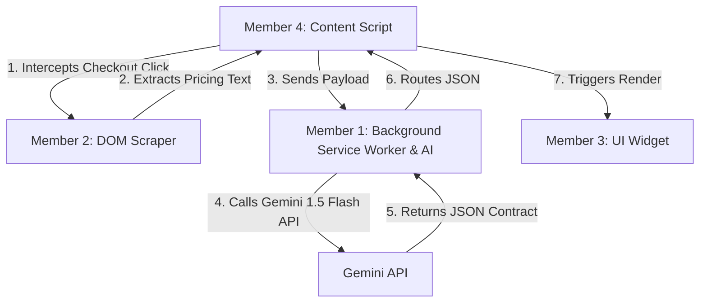

<p align="center">
  
</p>

<h1 align="center">TrapSight (Clearer-Terms)</h1>

<p align="center">
  <strong>AI-Powered Chrome Extension Exposing Fine-Print Traps, Auto-Renewal Gotchas, and Deceptive Checkout Pricing.</strong>
</p>

<p align="center">
  
  
  
  
  <a href="future.md"></a>
</p>

---

## ⚡ Overview

**TrapSight** is a premium, AI-powered Chrome extension designed to expose hidden traps, fine print, and deceptive pricing details in checkout forms. By intercepting the checkout flow, extracting pricing agreements, and analyzing them via the Gemini 1.5 Flash API, TrapSight translates complex legal jargon and subscription traps into simple, clear mathematics before the user completes their purchase.

---

## 🏗️ Project Architecture & Data Flow

TrapSight is divided into four modular components collaborating seamlessly:



1. **User Clicks "Checkout"**: Member 4's content script intercepts the action and pauses the checkout process.
2. **Scraping**: Member 2's scraping logic runs, targeting specific pricing elements in the DOM.
3. **AI Processing**: Member 1's background service worker sends the text to the Gemini API and obtains a structured JSON response.
4. **UI Warning**: Member 3's widget displays a modal freezing the page, showing the financial breakdown, and letting the user auto-scroll to the exact point of interest.

---

## 👥 Development Roles & Responsibilities

### 🎯 Member 2: DOM Targeting (The Scraper)
*   **Scope Restriction**: Limit scraping actions *exclusively* to demo and targeted checkout flows.
*   **Extraction Accuracy**: Write optimized CSS selectors to extract only pricing terms and summary containers (e.g., `document.querySelector('.checkout-summary').innerText`), avoiding unnecessary DOM noise.
*   **Routing Logic**: Implement clean routing maps matching the URL (`window.location.href`) to run the correct scraper.

### 🧠 Member 1: Background Script & AI Engine
*   **Setup**: Registers the service worker in `manifest.json`.
*   **API Connection**: Integrates Gemini 1.5 Flash API directly using the local API key.
*   **Prompting**: Implements a strict system prompt instructing the LLM to output predictable JSON schemas.

### 🎨 Member 3: UI/UX (The Alert Widget)
*   **Widget Design**: Implements a page-freezing alert widget that renders legal jargon as simple mathematical operations.
*   **Action Logic**: Handles the "Read" button, scrolling the user directly to the highlighted target selector.

### 🔌 Member 4: Content Script & Integration
*   **Interception**: Listens to checkout or proceed buttons and calls `event.preventDefault()` to pause navigation.
*   **Data Pipeline**: Manages the message port between content script and background service worker.

---

## 🛠️ Installation & Getting Started

1.  **Clone the Repository**:
    ```bash
    git clone https://github.com/seeramsujay/clearer-terms.git
    cd clearer-terms
    ```
2.  **Load the Extension in Chrome**:
    *   Open Chrome and navigate to `chrome://extensions/`.
    *   Enable **Developer mode** (toggle in the top-right corner).
    *   Click **Load unpacked** in the top-left corner.
    *   Select the `clearer-terms` folder.

---

## 📋 JSON Contract Specification

The Gemini API response processed by the background worker conforms to the following structure:

```json
{
  "hasHiddenFees": true,
  "summaryMath": {
    "basePrice": "$19.99/mo",
    "hiddenCharges": [
      {
        "label": "Activation Fee",
        "amount": "$15.00"
      },
      {
        "label": "Regulatory Recovery Fee",
        "amount": "$2.50/mo"
      }
    ],
    "totalFirstYearCost": "$284.88"
  },
  "warnings": [
    {
      "severity": "high",
      "message": "Auto-renews at full price of $39.99/mo after 3 months.",
      "domSelectorToHighlight": ".auto-renew-terms"
    }
  ]
}
```

---

## 🔮 Engineering Roadmap

To explore planned features including universal heuristic DOM scraping, FTC dark pattern classification, and on-device WebLLM inference, read [future.md](future.md).

---

## 📄 License

Distributed under the MIT License.
